<h1 align="center">inspecteur</h1>

<p align="center"><b>The processes of your Linux machine, at a glance.</b></p>

Inspecteur is a system monitor and task manager: what runs, what it uses, which services and sockets it has, what starts
with the session, and a way to end it. It is one small native program, written in [Odin](https://odin-lang.org) on
[gui_toolkit](https://github.com/sachahjkl/gui_toolkit). Its window comes up in about 270 ms, and it uses about 1 % of one
core while it refreshes its table each second.

Inspecteur is not a port, but it is strongly inspired by [TaskSlinger](http://taskslinger.net): a task manager of that
quality is what Linux lacked. Its sections are the same six: Processes, Performance, Services, Startup, Connections and
Information.

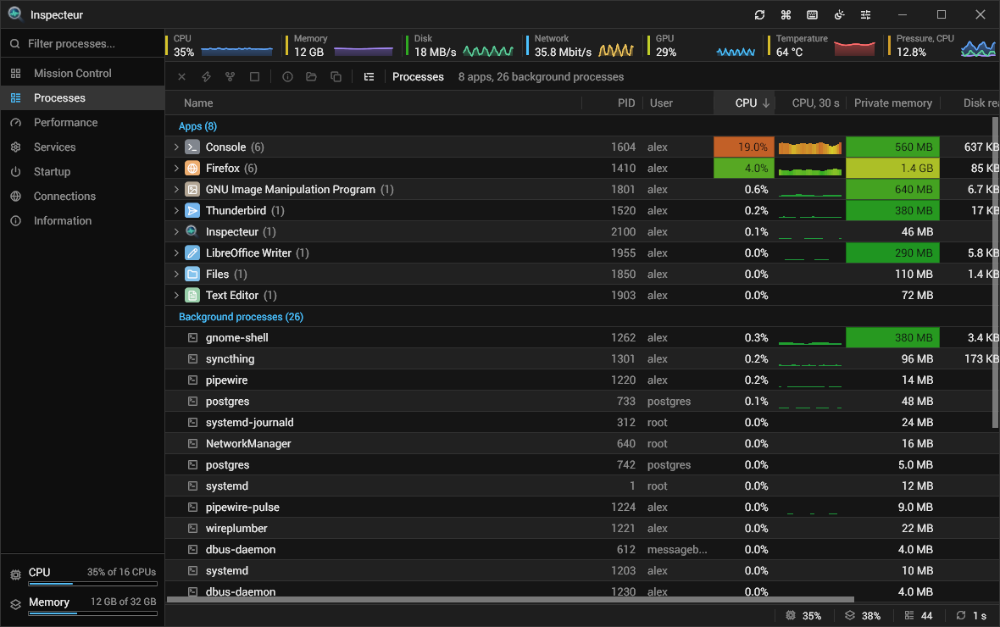

## Features

- **Mission Control** (Ctrl+1): the whole machine on one page, in panels you arrange: the machine's tiles and graphs,
  what the diagnosis says, the busiest processes by CPU and by memory, the failed services, the network's sockets, what
  starts with the session, the system. Drag a panel's tab into another stack, beside one, to an edge or out to float;
  resize the stacks; close a panel and bring it back from the panels' menu; the layout as at first. The layout is kept.

  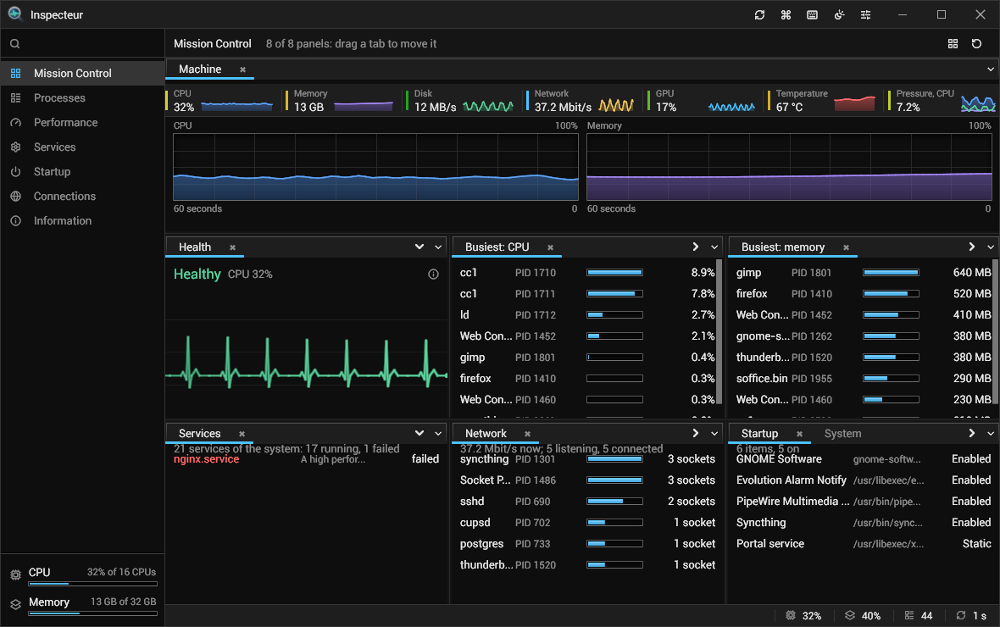
- **Processes**: name with the app's icon, PID, user, CPU %, private memory, disk read and write rates, threads, and more
  columns on a right click of the header (Ctrl+Shift+C): parent, state, priority, resident memory, GPU memory, start time,
  command line, executable. Read again each second; the refresh pauses (Ctrl+Space) and goes faster or slower from the
  title bar (Ctrl+Shift+R).
- **Apps and background processes**: a process that the desktop's menu knows (its desktop entry) is an app; the
  processes under it are in its group. A launcher (env, sudo, flatpak, systemd-run...) or an interpreter (Python, Node,
  a shell...) is never taken for an app. Or **every process under its parent**: Ctrl+T.
- **End task** (Delete) asks a process to end; **Kill** (Shift+Delete) ends it at once; **End process tree**
  (Ctrl+Delete) ends it and every process under it. A kill and a tree are asked first: the confirmation lists each
  process by its name and PID, and says when Inspecteur or the session would end with them. **Select many rows** with
  Ctrl and Shift clicks or Ctrl+A: End task and Kill act on all of them.
- **Suspend or resume** (Ctrl+P), **the priority** (Ctrl+Up, Ctrl+Down), **the affinity** (Ctrl+Shift+A), **Go to
  service** (Ctrl+Shift+S), **Search online** (Ctrl+Shift+F), **Create dump file** (Ctrl+Shift+D, with gdb's gcore).
  **Properties** (Alt+Enter, Enter): its threads, open files, modules and environment, each with a filter (Ctrl+F).
  Inspecteur does not suspend itself, what it runs under, or the desktop's compositor.
- **Performance**: CPU (overall or per logical processor, each with its core's temperature where the machine tells
  it), memory, disks, network interfaces and GPUs, sixty readings of history each. A laptop's GPU that sleeps is not
  woken to be read.
- **Services**: systemd's services, the system's or the user's: their state, whether they start by themselves, their
  main process and memory; under the table, the selected one's unit file, tasks, CPU time and its journal: each entry's time, level in
  its colour, program and message; all, warnings or errors with their counts, this boot or every boot, followed live, its
  own search, the selected entry whole, Copy; in a window of its own for a second screen (Ctrl+Shift+J)
  (Ctrl+I). Start, Stop, Restart (both asked first), Enable, Disable, over D-Bus; for a system service the manager asks
  polkit, which can ask for a password, and the footer says what it answered.
- **Startup**: the XDG autostart entries and the user's systemd services that start with the session; turn one on or off,
  open its file's folder.
- **Connections**: every TCP and UDP socket, IPv4 and IPv6, with its process; End task, Kill, Open in Processes.
- **Information**: the system, the processor, the memory, the GPUs, the disks and file systems, the network interfaces,
  the screens and the batteries. **Copy all** copies it as text.
- **Every action has its key**, said in its menu line and its button's tooltip. The **command palette** (Ctrl+K,
  Ctrl+Shift+P) finds any action or section by its words; **F1** lists every key.
- **Sort** by any column: click its title; click again to reverse, a third time for the rows as they are read. **Move a
  column** by dragging its title sideways. Hold **Ctrl** to stop the refresh while you look (the footer says so).
  **Filter as you type**, wherever the keyboard is: the filter filters the section shown. The tables keep their widths,
  the order of their columns and their sort; the window opens on the section shown last, the CPU's page as it was left.
  A text too narrow for its place shows it whole when the pointer rests on it.
- **Install and updates**: a downloaded copy installs itself for the user (the program, its menu entry with an action
  per section, its icons); the installed copy updates itself from the signed releases. On NixOS a classic install runs
  by itself; the Nix package is installed and updated by Nix.
- **Settings** (Ctrl+, or the title bar's button): every preference on a page, searched as you type, applied at once.
- **Themes**: every theme of gui_toolkit, light or dark (Ctrl+Shift+L); the zoom with Ctrl+wheel, Ctrl+=, Ctrl+- and Ctrl+0.
- **One Inspecteur at a time**: a second start shows its section in the one that runs.

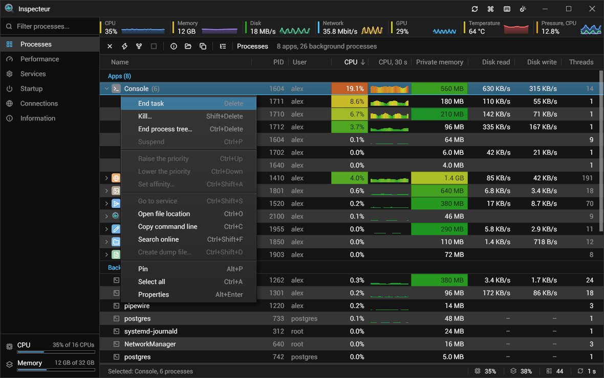

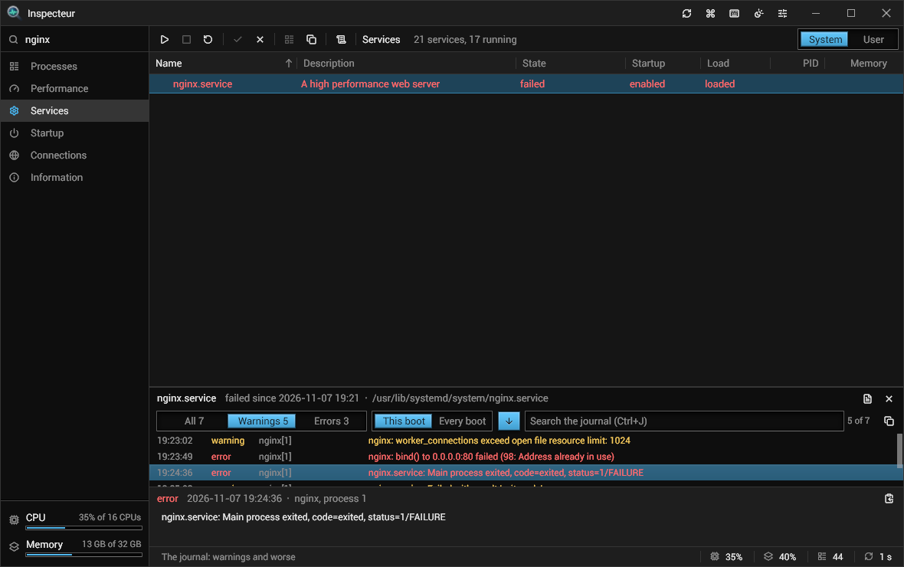

| | |
|---|---|
| 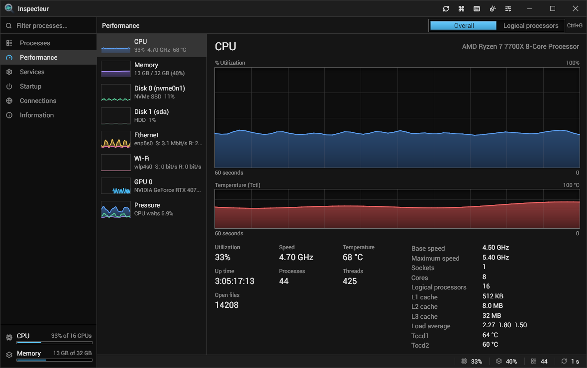 | 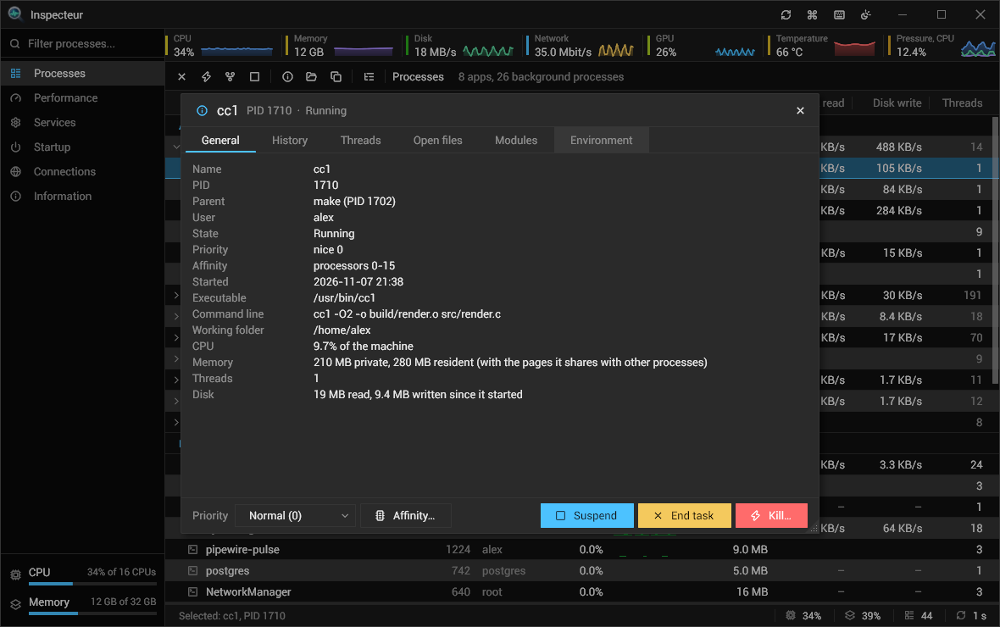 |
| 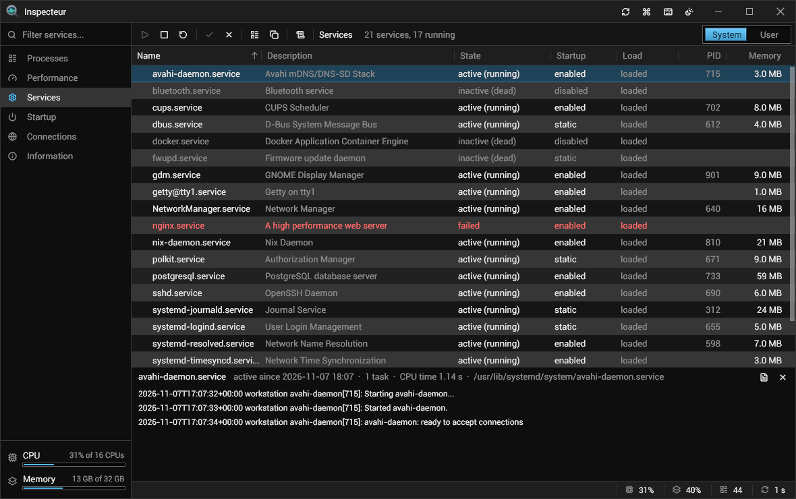 | 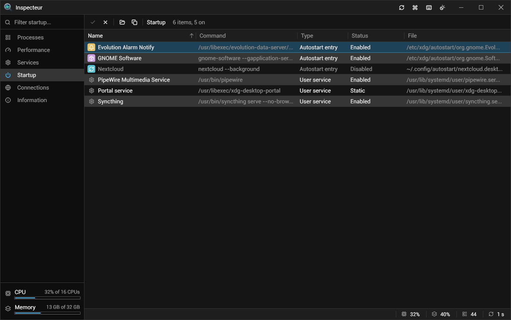 |
| 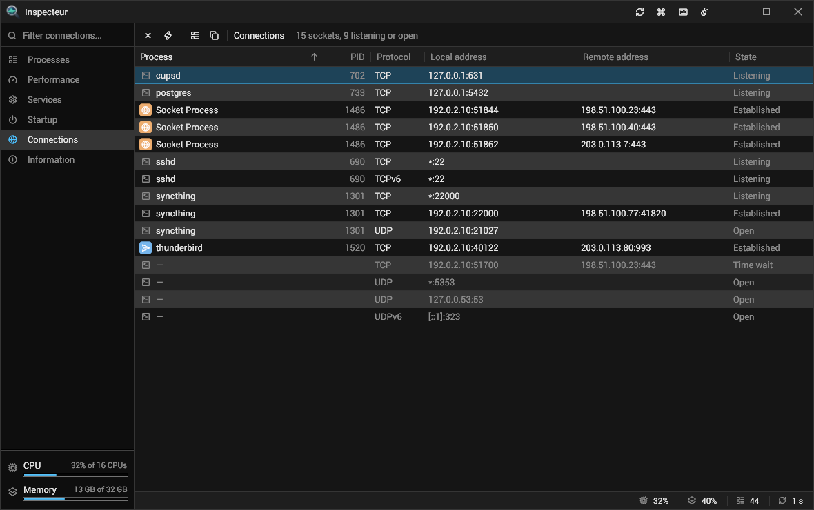 | 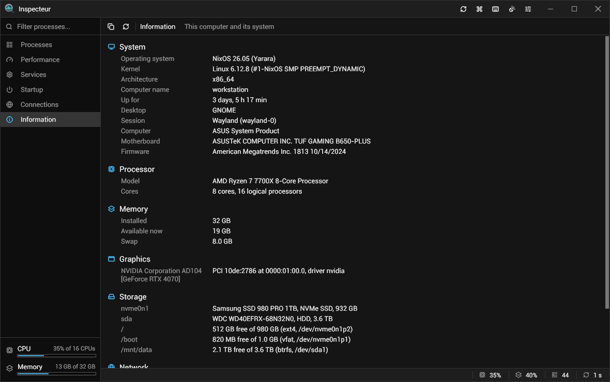 |
| 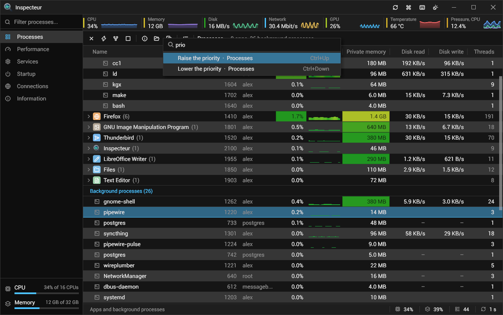 | 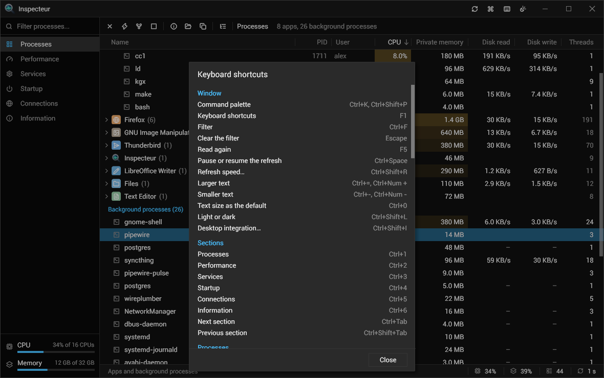 |
| 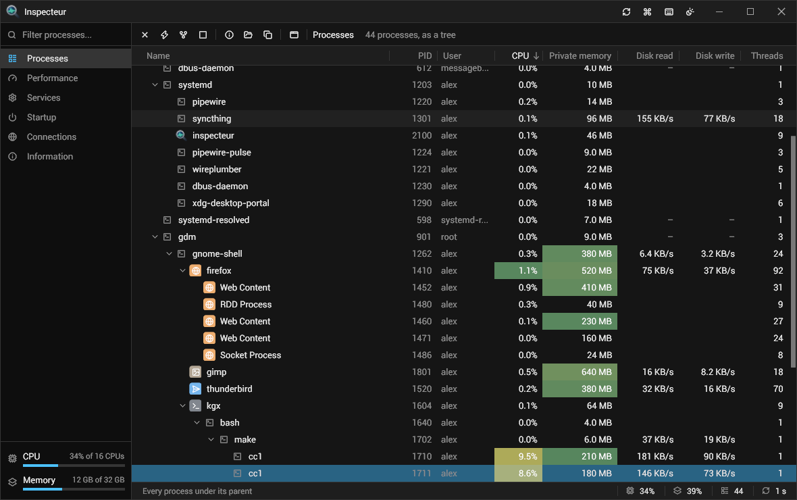 | 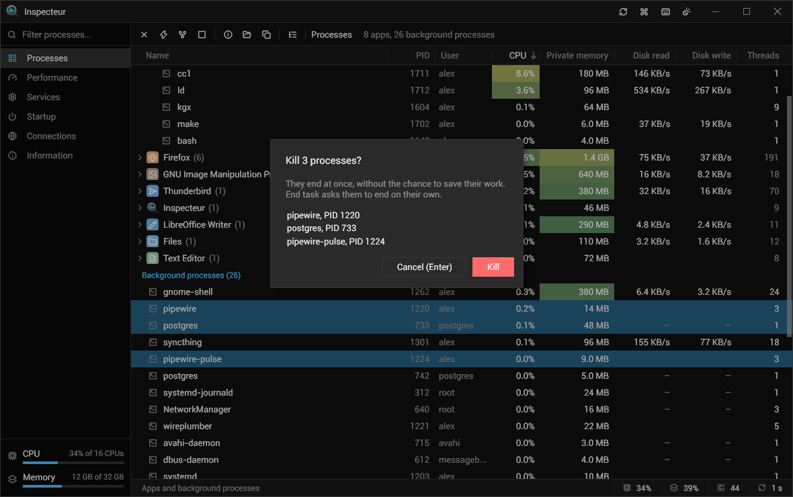 |

The pictures show the demo's made-up machine (`inspecteur --demo`), not a real one.

## Use

| Key | |
|---|---|
| typing, Ctrl+F | filter the section shown; Escape clears the filter |
| Ctrl+K, Ctrl+Shift+P | the command palette (its edges and corner resize it) |
| F1 | every key |
| Ctrl+1 to Ctrl+7, Ctrl+Tab, Ctrl+Shift+Tab | show a section (Ctrl+1: Mission Control), the next, the previous |
| F5 | read the section again now |
| Ctrl+Space, Ctrl+Shift+R | pause or resume the refresh; its speed |
| Ctrl+wheel, Ctrl+=, Ctrl+-, Ctrl+0 | zoom in, out, 100 % |
| Up, Down, Page Up, Page Down, Home, End | move in a table (Ctrl+Home, Ctrl+End while the filter has text) |
| Menu, Shift+F10, a right click | the row's menu |
| Enter, a double click | the row's default action: open an app's group or a process's Properties, Open in Processes, Open file location |
| Ctrl+Shift+L | light or dark |
| Ctrl+, | the settings |
| Ctrl+Shift+I | the install: install, repair, uninstall |

| Section | Keys |
|---|---|
| Processes | Delete End task, Shift+Delete Kill, Ctrl+Delete End process tree, Ctrl+A Select all (Ctrl and Shift clicks too), Ctrl+P Suspend or resume, Ctrl+Up and Ctrl+Down the priority, Ctrl+Shift+A Set affinity, Ctrl+Shift+S Go to service, Ctrl+Shift+F Search online, Ctrl+Shift+D Create dump file, Alt+Enter Properties, Ctrl+O Open file location, Ctrl+C Copy command line, Right and Left open and close a group, Ctrl+T the tree or the apps, Ctrl+Shift+C Columns |
| Properties | Ctrl+Tab and Ctrl+Shift+Tab the tabs, Ctrl+F the filter of a list, Ctrl+P, Delete, Shift+Delete, Ctrl+Up, Ctrl+Down, Ctrl+Shift+A as in Processes, Escape closes |
| Performance | Up and Down the devices, Ctrl+G one graph per logical processor |
| Services | Ctrl+S Start, Delete Stop, Ctrl+R Restart, Ctrl+E Enable, Ctrl+D Disable, Enter Open in Processes, Ctrl+C Copy name, Ctrl+I the details and the journal, Ctrl+O Open unit file, Ctrl+U System or User; the journal: Ctrl+J search, Alt+L all, warnings, errors, Alt+B this boot or every boot, Alt+F follow, Alt+C copy the entries shown, Alt+Shift+C copy the entry, Ctrl+Shift+J the journal in its own window (Ctrl+W closes it) |
| Startup | Ctrl+E Enable, Ctrl+D Disable, Space toggles, Enter Open file location, Ctrl+C Copy command |
| Connections | Delete End task, Shift+Delete Kill, Enter Open in Processes, Ctrl+C Copy address |
| Information | Ctrl+C Copy all |

CPU % is a share of the whole machine: 100 % is every core busy. Preferences: [docs/configuration.md](docs/configuration.md).

## Install

- **The archive** of a release: `inspecteur-<version>-linux-x64.tar.gz`, one program. At its first start it offers to
  install itself for the user (or `./inspecteur install`): the program in `~/.local/share/inspecteur`, its menu entry and
  its icons. The installed copy updates itself from the signed releases (`update.auto`). It needs a Wayland desktop,
  Vulkan and fontconfig. On NixOS the install builds the libraries it needs with `nix-build` and points the copy at them.
- **Nix**: `nix run git+https://github.com/sachahjkl/inspecteur` (Nix 2.27 or later: the flake asks for its submodule,
  `inputs.self.submodules`; with an older Nix, add `?submodules=1`). A `github:` URL does not bring the submodule: use
  the `git+https` one. The package brings its desktop entry and icons. On a Linux other than NixOS, a program from Nix
  finds no Vulkan driver of the system: start it through [nixGL](https://github.com/nix-community/nixGL)
  (`nix run --impure github:nix-community/nixGL -- inspecteur`).

## Install

| | |
|---|---|
| `inspecteur --setup`, Ctrl+Shift+I | the install's dialog: Install, Repair, Upgrade, Uninstall, Open the installed copy |
| `inspecteur install` | installs this copy for the user |
| `inspecteur uninstall` | takes the install away; the preferences stay |
| `inspecteur status` | the install's state: exit 0 installed (or a Nix package), 2 to repair, 1 not installed |

A copy that runs from the Nix store is the Nix package's: Nix installs and updates it, and nothing is offered. To open
Inspecteur with Ctrl+Shift+Escape, bind that key to `inspecteur` in the desktop's keyboard settings.

## Build

```sh
git clone --recurse-submodules <this repository> && cd inspecteur
nix develop
./build.sh release      # build/inspecteur
```

Every step of the project is a command of `tools/inspecteurtool`: `build`, `test`, `check`, `live` (the real program in a
headless sway), `shots`, `bench`, `logo`, `desktop_files`, `notices`. See [docs/development.md](docs/development.md).

## Documentation

- [Configuration](docs/configuration.md): every preference.
- [Architecture](docs/architecture.md): how the processes, services, sockets and the rest are read and shown, and why;
  what a port to Windows writes.
- [Development](docs/development.md): building, testing, `inspecteurtool`.

## Licence

MIT, see [LICENSE](LICENSE). The program embeds and links works under their own licences (gui_toolkit, its fonts, the
[Lucide](https://lucide.dev) icons, wgpu-native, the text library's Rust crates): see
[THIRD-PARTY-NOTICES](THIRD-PARTY-NOTICES).
